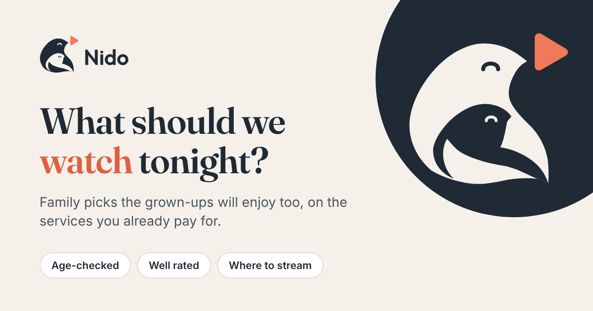
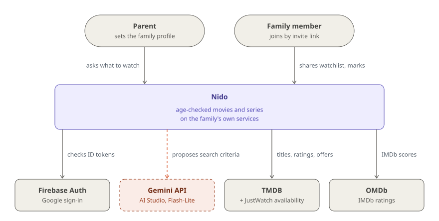

# Nido

**Movies and series the whole family enjoys, age-checked against 9 countries' ratings, on services you already pay for.**

[](https://github.com/glrodasz/nido-agent/actions/workflows/ci.yml)
[](LICENSE)


<br clear="left">

[**Live app**](https://nido-agent.web.app) · [How it works](#how-it-works) · [Architecture](#architecture) · [Quick start](#quick-start) · [Deploy](docs/SETUP.md)



## Why

Picking something to watch as a family means answering three questions at once, usually in three
different apps:

1. What is worth watching?
2. Is it appropriate for my child's age and sensitivities?
3. Where can we watch it with our existing subscriptions?

Nido answers all three in one place. A parent saves the family profile once (children's ages,
services, catalog regions, content to avoid) and then either uses the **Find** filters or asks
**Ask Nido** in plain words ("a series with short episodes that isn't scary"). Every suggestion
comes back as a card with its official ratings, IMDb score and streaming offers, each with its
source. Family members join with an invite link and share the profile, watchlist and marks.

Scope today: personal, non-commercial use, Swedish catalog by default, English app (the
signed-out landing page is in Spanish). Catalog regions are a family setting (a VPN can add more);
age ratings never depend on them. Services: Netflix, Disney+, HBO Max, Prime Video and Apple TV+.

### Design principles

| Principle | In practice |
|---|---|
| **The LLM proposes, code decides** | Gemini turns a request into search criteria and explains the result. Filtering and ranking are deterministic ([`ranking.py`](src/nido/ranking.py)), and the cards are built from tool output, never from the model's text. |
| **Official ratings first** | Ratings from nine countries (US, GB, DE, NL, FR, SE, NO, DK, FI) are homologated onto one age scale and the median is the baseline ([`catalog.py`](src/nido/catalog.py)). Originals are always shown, and the baseline is kept apart from any AI assessment. Fitting it never means "appropriate for your child". |
| **Every claim has a source** | Ratings, classifications and offers carry their source and retrieval date ([`models.py`](src/nido/models.py)). Missing data is shown as missing, never guessed. |
| **Evidence and AI stay apart** | The data model keeps guidance observations (official, editorial, user, AI inference) append-only, and AI summaries must cite them. For now Nido links to Common Sense Media and the IMDb Parents Guide instead of describing scenes. |
| **The saved profile is the floor** | Children's ages, content to avoid and banned titles reach the tools through session state, not through the model: a chat message can narrow a search, never loosen it. |
| **Free tier** | One ADK agent, Gemini Flash-Lite with a fallback model, a per-turn model call cap, daily quotas per family and cached API responses. |

## Quick start

Requires [uv](https://docs.astral.sh/uv/), Node.js 22.12+, a free
[TMDB API Read Access Token](https://www.themoviedb.org/settings/api) and, optionally, an
[OMDb key](https://www.omdbapi.com/apikey.aspx) (IMDb scores) and a
[Gemini API key](https://aistudio.google.com/) (Ask Nido).

```bash
uv sync
cp .env.example .env                      # add TMDB_API_TOKEN, OMDB_API_KEY, GOOGLE_API_KEY
uv run nido serve                         # API on http://127.0.0.1:8080 (no sign-in, memory store)
(cd web && npm install && npm run dev)    # web app on http://localhost:4321, /api proxied to 8080
```

Open the web app, save a family profile and search. Without `GOOGLE_API_KEY` the chat box is
hidden and the Find filters still work.

<details>
<summary><b>Tests, the ADK dev UI, the coverage check and a single-origin run</b></summary>

```bash
uv run pytest -q                          # offline: TMDB and OMDb are mocked
(cd web && npm test)                      # vitest
uv run adk web agents                     # chat with the agent at http://localhost:8000
uv run nido coverage                      # ratings, IMDb ids and watch links per service in SE
uv run python evals/prompt_injection.py   # live prompt-injection attacks (spends model quota)

# One origin: the API also serves the built web app
(cd web && npm run build) && NIDO_WEB_DIR=web/dist uv run nido serve
```

</details>

Deploying your own instance to Cloud Run and Firebase Hosting is covered step by step in
[docs/SETUP.md](docs/SETUP.md).

## How it works

### Two ways to ask

| | Find filters | Ask Nido |
|---|---|---|
| Endpoint | `POST /api/search` | `POST /api/chat` |
| Model calls | none | at most `NIDO_MAX_LLM_CALLS` (8) per turn |
| Who writes the criteria | the filter panel, starting from the profile's defaults | Gemini, from the parent's message and the profile |
| What runs | `Toolbox.search` | the ADK agent, which calls `find_titles` (a shortlist) or `look_up_title` ("is Bluey OK for us?"), both backed by the same search |
| Daily quota per family | 150 searches | 40 turns |

Both return the same card shape, so the web app renders results the same way. In chat the cards
follow the answer: titles the reply names come first, in its order.

### From a request to a shortlist

| Step | How |
|---|---|
| Pool | TMDB discover per catalog region, sorted by popularity and filtered by the family's services, genres, runtime and release year. US certifications pre-filter one step looser than the youngest child's age; pages of 20 are read (up to 8) until 30 titles pass the age and availability rules. Banned titles are skipped before their details are read. |
| Age baseline | Each country's rating is mapped to an age; within a country the strictest version counts, and the baseline is the median across countries, rounded up. A title rated above the youngest child is out. |
| Availability | Offers come from JustWatch via TMDB. Subscription or ad-supported offers on a family service count as included; rent, buy and add-on offers are shown with a caution. A title with no offer in the family's regions is dropped. |
| IMDb score | Looked up through OMDb only for titles that already pass the rules (the free key allows about 1,000 calls a day). Titles under 4.0 never show. |
| Ranking | 0.6 × Bayesian-weighted IMDb score + 0.25 if included in a subscription + 0.15 for a preferred genre + 0.2 × recency (linear over 20 years) − 0.2 per flagged content category. Top 20 make the shortlist. |
| Near misses | When nothing fits, up to 3 of the closest titles are shown, each with the profile rules it breaks. |

TMDB details are cached for a day and IMDb scores for a week in Firestore, so a cached value still
reports when it was actually fetched.

### The family

Any verified Google account starts its own family on first sign-in; an invite link (single use,
valid 7 days, up to 8 members) moves another account into it. The profile, watchlist and title
marks belong to the family. A title can be marked seen, liked (by the adults or the child), on repeat or
**Don't suggest**, either always or until the youngest child reaches an age.

### Guardrails

The model writes the tool arguments and a message can steer it, so the limits that matter are
code. The saved profile's ages and avoided content are a floor the tools enforce
(`family_guard`), banned titles never reach the model, and replies lose every link outside the
guidance and metadata sources and the tools' own links (`safe_links`). Code-level guarantees are
tested in [`tests/test_injection.py`](tests/test_injection.py); live attacks on the real model
are in [`evals/prompt_injection.py`](evals/prompt_injection.py).

## Architecture

<picture>
  <source media="(prefers-color-scheme: dark)" srcset="docs/diagrams/context-dark.svg">
  
</picture>

Two kinds of people use Nido: the **parent** who sets up the family profile and asks for
suggestions, and **family members** who join with an invite link and share the same profile,
watchlist and marks. Firebase Auth signs everyone in with Google; TMDB (with JustWatch
availability) and OMDb supply every fact Nido shows.

The dashed coral line is the only LLM dependency, and it is optional: Gemini proposes search
criteria and writes a short explanation, while which titles appear, and every rating and offer on
their cards, comes from code and the data sources. Without a Gemini key the Find filters work
unchanged.

Containers, one Ask Nido turn and the search pipeline are drawn and explained in
[**docs/ARCHITECTURE.md**](docs/ARCHITECTURE.md).

### Tech stack

**Agent:** Google ADK 2.11, Gemini Flash-Lite (AI Studio free tier) with a fallback model ·
**Backend:** Python 3.12+, FastAPI, Pydantic, httpx, uv · **Data:** TMDB, JustWatch via TMDB,
OMDb, Firestore · **Infra:** Cloud Run, Firebase Hosting, Firebase Auth, Secret Manager, Artifact
Registry, Workload Identity Federation, a Cloud Workflows billing kill switch · **Front end:**
Astro, Preact, TypeScript, Vitest · **CI/CD:** GitHub Actions · **Quality:** ruff, pytest,
`astro check`, live prompt-injection evals

## Configuration

Settings are environment variables, read from `.env` locally ([`.env.example`](.env.example)) and
set by [`deploy.yml`](.github/workflows/deploy.yml) on Cloud Run. The ones you are most likely to
change:

| Variable | Default | What |
|---|---|---|
| `TMDB_API_TOKEN` | (required) | TMDB v4 API Read Access Token, not the v3 key |
| `OMDB_API_KEY` | unset | IMDb scores; without it cards show no IMDb score |
| `GOOGLE_API_KEY` | unset | Gemini for Ask Nido; without it chat is off |
| `NIDO_REGIONS` | `SE` | default catalog regions, comma-separated |
| `NIDO_MODEL` / `NIDO_FALLBACK_MODEL` | `gemini-3.1-flash-lite` / `gemini-3.5-flash-lite` | main model and the one used on 429/5xx (`none` turns the fallback off) |
| `NIDO_MAX_LLM_CALLS` | `8` | model calls per chat turn |
| `NIDO_MAX_CHAT_TURNS_PER_DAY` / `NIDO_MAX_SEARCHES_PER_DAY` | `40` / `150` | daily quotas per family, reset at 00:00 UTC |
| `NIDO_ALLOWED_EMAILS` | unset | families these emails own have no daily quota |
| `NIDO_STORE` / `NIDO_AUTH` | `memory` / `none` locally | `firestore` / `firebase` on Cloud Run |

The full list, with the GCP and GitHub variables, is in [docs/SETUP.md](docs/SETUP.md).

### Project layout

| Path | What |
|---|---|
| `src/nido/models.py` | Data model with provenance |
| `src/nido/catalog.py` | Supported services, official classification systems |
| `src/nido/sources/` | TMDB and OMDb clients |
| `src/nido/ranking.py` | Deterministic filter and ranking |
| `src/nido/agent/` | ADK agent, tools, model fallback, model call budget |
| `src/nido/server.py` | Web API: profile, search, chat, watchlist, marks, family |
| `src/nido/store.py` | Firestore (and in-memory) store, API response cache, quotas |
| `src/nido/auth.py` | Firebase ID token check and email allowlist |
| `src/nido/coverage.py` | `nido coverage`: data coverage per service |
| `agents/nido_agent/` | Shim for `adk web` / `adk run` |
| `web/` | Astro + Preact app |
| `tests/`, `evals/` | pytest suite, live prompt-injection evals |
| `infra/`, `firebase.json`, `firestore.rules` | GCP bootstrap, billing kill switch, Firebase Hosting and rules |

## Documentation

| Doc | What's in it |
|---|---|
| [Architecture](docs/ARCHITECTURE.md) | Containers, one Ask Nido turn, the search pipeline and the Firestore layout |
| [Setup and deployment](docs/SETUP.md) | Google Cloud and Firebase bootstrap, GitHub variables, deploy, cost guard and the billing kill switch |
| [AGENTS.md](AGENTS.md) | Content rules for coding agents: which genres Nido may offer |

## Contributing

Issues and pull requests are welcome. The common changes:

- **A genre:** `GENRE_TYPES` in [`web/src/logic/format.ts`](web/src/logic/format.ts), following
  the rules in [AGENTS.md](AGENTS.md) (no violent or adult-leaning genres, and every genre must
  exist in TMDB for its media types); `tests/test_tmdb.py` checks it.
- **A streaming service:** `SERVICES` in [`src/nido/catalog.py`](src/nido/catalog.py), with its
  TMDB provider names; `uv run nido coverage` shows whether they still match.
- **A rating country:** `SYSTEMS` in the same file, mapping each official value to an age.

CI runs ruff (lint and format), pytest and import checks for the ADK shim and the API; `astro
check`, vitest and a build for the web app; and a Docker build of the API image.

## License

[Apache-2.0](LICENSE). Metadata and certifications from [TMDB](https://www.themoviedb.org/);
this product uses the TMDB API but is not endorsed or certified by TMDB. Streaming availability
from [JustWatch](https://www.justwatch.com/) via TMDB. IMDb ratings via
[OMDb](https://www.omdbapi.com/). The Fraunces font is under the
[SIL Open Font License](web/public/fonts/Fraunces-OFL.txt).

<sub>Built by [Guillermo Rodas](https://github.com/glrodasz).</sub>
