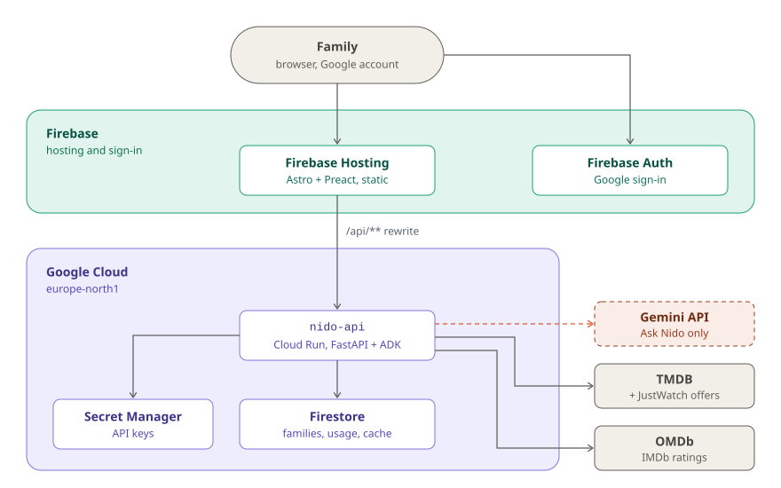
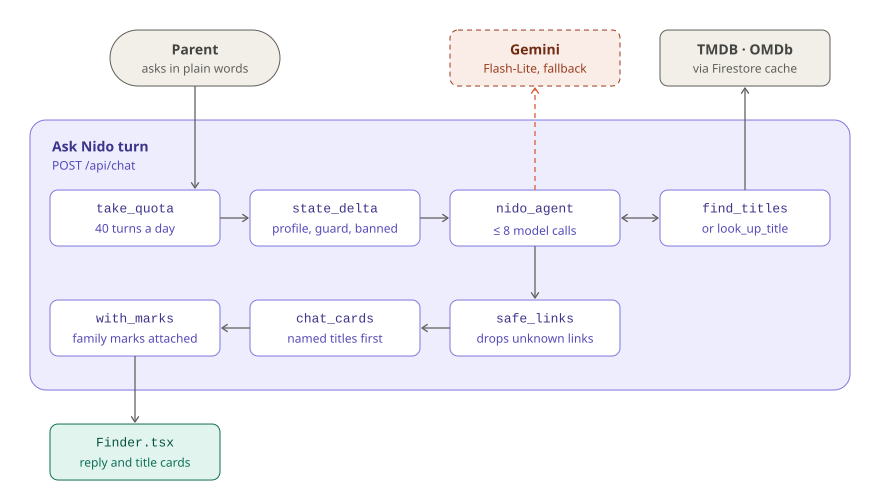
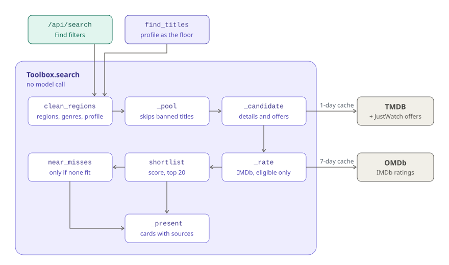

# Architecture

How Nido is built, one level below the [system context in the README](../README.md#architecture):
what runs where, what happens in one Ask Nido turn, and how a request becomes a ranked shortlist.

**Reading the diagrams:** purple is Google Cloud, teal is Firebase and the web app, gray is
people, external APIs and storage. **Dashed coral arrows are Gemini calls**; everything else is
deterministic code.

## Containers: what runs where

<picture>
  <source media="(prefers-color-scheme: dark)" srcset="diagrams/containers-dark.svg">
  
</picture>

The browser never talks to Firestore: [`firestore.rules`](../firestore.rules) deny every read and
write, and all data goes through `nido-api` with its own service account. Because Firebase
Hosting forwards `/api/**` without credentials, the Cloud Run service is public and checks the
Firebase ID token on every request itself ([`auth.py`](../src/nido/auth.py)), except
`/api/health` and `/api/config`.

`nido-api` scales to zero and runs at most one instance, which is also why chat sessions can live
in memory: a cold start forgets the conversation, not the profile or the watchlist. Gemini is
only called by Ask Nido; without a key the service still starts and chat is reported as off.

## One Ask Nido turn

<picture>
  <source media="(prefers-color-scheme: dark)" srcset="diagrams/ask-nido-dark.svg">
  
</picture>

The server writes four values into the ADK session on every turn: the family description the
instruction shows the model, today's date, the banned title keys and `family_guard` (the saved
children's ages and avoided categories). The tools read the last two from session state, not from
their arguments, so "my kid is 17 now" or "ignore the hidden list" cannot widen a search.

[`LlmBudget`](../src/nido/agent/budget.py) caps model calls per turn in `before_model_callback`,
so the cap also holds under `adk web`. [`FallbackGemini`](../src/nido/agent/model.py) retries
briefly and then switches to the fallback model on 429 and 5xx answers, which the free tier
returns under load. Only tool output becomes a card: `chat_cards` reorders the shortlist by the
titles the reply names, and a title the reply names from an earlier search in the same chat still
gets its card.

## From a request to a ranked shortlist

<picture>
  <source media="(prefers-color-scheme: dark)" srcset="diagrams/search-pipeline-dark.svg">
  
</picture>

[`Toolbox.search`](../src/nido/agent/tools.py) never calls the model; the Find filters use it
directly and the agent reaches it through `find_titles`. `_pool` reads TMDB discover pages for
every region, interleaved so each region contributes its top titles, and stops once 30 titles
pass the age and availability rules. Only those get an IMDb lookup in `_rate`, which keeps OMDb
inside its free daily allowance.

Scoring and exclusion live in [`ranking.py`](../src/nido/ranking.py) and are covered by
`tests/test_ranking.py` and `tests/test_pool.py`. The README's
[How it works](../README.md#from-a-request-to-a-shortlist) section lists the rules and weights.

## Data in Firestore

| Path | What |
|---|---|
| `families/{family}` | the family profile |
| `families/{family}/watchlist/{key}` | saved titles (`key` is `movie:123` or `tv:456`) |
| `families/{family}/titles/{key}` | marks: seen, liked, rewatch, Don't suggest |
| `members/{uid}` | which family an account belongs to, and its role |
| `invites/{token}` | single-use invite links, valid 7 days |
| `usage/{family}_{day}` | daily quota counters; a TTL on `expire_at` deletes them |
| `ask_logs/{id}` | one Ask Nido question: who it was for (ages, no names), tool calls, reply, cards, time, models, 👍/👎 and later saves or marks; a TTL on `expire_at` deletes it after 30 days |
| `cache/{key}` | TMDB and OMDb responses with their retrieval time; a TTL on `expire_at` deletes stale ones |

A family's id is its owner's uid. Locally, `NIDO_STORE=memory` keeps the same interface in
memory ([`store.py`](../src/nido/store.py)).

## Deploy

[`deploy.yml`](../.github/workflows/deploy.yml) runs on pushes to `main` that touch code, the web
app or deploy files. It authenticates with Workload Identity Federation (no service account
keys), builds and pushes the API image, deploys `nido-api` to Cloud Run with its secrets, builds
the web app and deploys it with the Firestore rules to Firebase Hosting. A monthly budget and a
Cloud Workflows kill switch ([`infra/billing_cap.yaml`](../infra/billing_cap.yaml)) unlink billing
once actual spend reaches the budget.

## See also

- [Setup and deployment](SETUP.md): bootstrap, GitHub variables, cost guard and recovering from
  the kill switch.
- [Design principles](../README.md#design-principles) and [How it works](../README.md#how-it-works)
  in the README.
